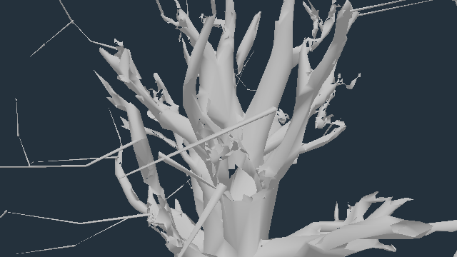
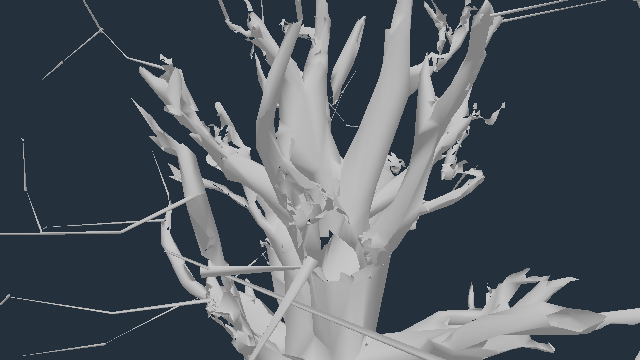

# Retained source-oak twig grafts

Live **0.0.33 · b317734** retains three near-detail twig roots on `oak/tree-1505` whose first stem segments miss preceding wood. These are **twig graft origins in the crown**, not floating trunk feet. The candidate extends #696's existing post-seating wood repair to this one source-oak template. It changes no foliage styling, material, contact tolerance, tree placement or collision geometry.

## Geometry reproduction

[Passing real-model contact measurements](proofs/source-oak-roots/model-contacts.json), from the delivered GLB source factory:

| Logical twig | Original root-ring-centre distance, local m | Candidate, local m |
| --- | ---: | ---: |
| 48 | 0.367618 | 0.033399 |
| 50 | 0.188639 | 0.032393 |
| 83 | 0.874186 | 0.047466 |

Three flags above the existing 0.12 local-m tolerance become zero. Independently, first rendered stem segments crossing **preceding actual wood triangles** change **0→3**; own and later twigs cannot satisfy that check. The distances are root-ring-centre distances, not residual surface gaps. Twig tips, source wood prefix, triangle indices and collision prefix remain fixed. The live wood material has **alphaTest 0 and transparent false**; this is not a leaf-alpha sampling inference.

A separate [six-direction rest-geometry probe](proofs/source-oak-roots/root-rays.json) finds no preceding-wood hit in any axis direction from roots 48 and 83. Root 50 only hits a front-facing triangle 6.152 m away along +X. These are additional observations against a buried-root interpretation, not a formal signed-volume classification of open meshes.

The selected instance is `tree:wild:42:31`, at **(−109.566, 2.889, 28.313)**. Its three original root centres in world coordinates are:

| Twig | x | y | z |
| --- | ---: | ---: | ---: |
| 83 | −112.277 | 8.370 | 26.648 |
| 50 | −106.636 | 6.451 | 27.951 |
| 48 | −111.536 | 9.113 | 30.450 |

These are three origins in a shared instanced template, not three separate tree instances.

## Compiled agreement and controls

Independent inspection of compiled **fe4cc3ed5** matches the tested repair at all three wood LODs. Every actual registered leaf attribute/index hash equals live after runtime leaf seating. Middle/far wood also remains byte-identical to live. [Live data](proofs/source-oak-roots/live-geometry.json), [compiled data](proofs/source-oak-roots/compiled-geometry.json), [comparison](proofs/source-oak-roots/compiled-comparison.json).

| Detail | Wood triangles before / after | Leaf triangles before / after |
| --- | ---: | ---: |
| Near | 9,185 / 9,185 | 10,534 / 10,534 |
| Middle | 4,914 / 4,914 | 3,398 / 3,398 |
| Far | 2,636 / 2,636 | 980 / 980 |

Near total stays **19,719 triangles**. All source twig tips, original wood/collision prefix and foliage buffers are covered by the model regression. 23 focused tests across six files, type check and production build pass.

## Rendered evidence and limits

**Isolated-wood diagnostic:** actual registered geometry, neutral grey material and custom lighting, no foliage, actors, wind or postprocessing. This makes the grafts readable; it is not game appearance or player visibility proof. All three before/after pairs change; every restored control matches exactly. Each uses one draw and 9,185 triangles, zero errors.




**Native full scene:** three High-preset road-player fixtures, cameras three metres behind the player and above terrain, fixed wind state, hour 15. Player and camera collider checks pass. These keep the game's materials, lighting, post/MSAA pipeline and other geometry. Every restored baseline matches exactly. Foreground pine foliage occludes the target joins: these views do **not** establish that all three root caps are visible or that crown quality is finished. They are inspection poses, not recorded input-driven walks or animated-wind verification.

[Full native before/after/restored images and measured counters](proofs/source-oak-roots/native/report.json), [camera/player controls and opaque material check](proofs/source-oak-roots/camera-controls.json), [road fixtures](proofs/source-oak-roots/road-views.json). Initial first-person fixture images were rejected because the camera entered the hero; they are not retained as proof.

## Cost

| Cost | Change |
| --- | --- |
| Source geometry vertex/index payload sizes | unchanged |
| Near/middle/far template triangles | unchanged |
| Native inspection draw/triangle counters | equal within every pair; shadows explicitly refreshed |
| Shader source and per-invocation texture taps | unchanged |
| Per-frame JS / dynamic upload code | unchanged |
| Initialization | one additional source-template wood rebuild; not benchmarked |

No hardware FPS, GPU timing or heat improvement is claimed. The stock exact-head budget is pending; no PASS is claimed for it here. The production PR is stacked on #696 for the shared repair helper.

## Reproduce

Use the accompanying proof branch for the read-only inspectors and diagnostic utilities. The production head is **fe4cc3ed5**.

```sh
npx vitest run tests/presentation/sourceOakRootContact.test.ts tests/presentation/heroTwigRootContact.test.ts tests/presentation/twigRootContact.test.ts tests/presentation/twigTangentFrame.test.ts tests/presentation/twigBarkSearch.test.ts tests/presentation/canopyBaseline.test.ts
npm run build
node tools/inspect-source-oak-geometry.mjs live-geometry.json
node tools/inspect-source-oak-geometry.mjs compiled-geometry.json BUILD_URL
node tools/check-source-oak-fixtures.mjs docs/perf/proofs/source-oak-roots/road-views.json camera-controls.json
node tools/repro-source-oak-root-contact.mjs --out native-proof --paths docs/perf/proofs/source-oak-roots/road-views.json
node tools/repro-source-oak-wood-diagnostic.mjs wood-diagnostic docs/perf/proofs/source-oak-roots/road-views.json
```

The geometry inspector accepts a second positional build URL. The normal-scene capture borrows the repaired source wood into live; independent compiled hashes establish agreement with the candidate. No production materials or tree art are edited.
