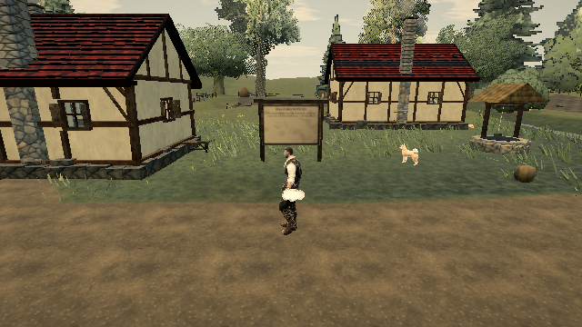

# Prepare the first spray draw before play

Published reference: [0.0.18 · 421d34b](https://ael-dev3.github.io/Tervain/); tracking [#326](https://github.com/ael-dev3/Tervain/issues/326).

## Finding

On the published build, a controlled first 24-drop spray performs three `bufferData` allocations (9,600 bytes total) and creates one vertex-array object inside the first visible splash frame. The next unchanged draw performs neither. [Original native-pool counters](../../proofs/spray-first-draw/published-first-use.json). There are **zero new shader links**: this probe does not establish shader compilation as a cause of the night/mud hitch.

The empty spray pool is hidden with a zero draw range during startup. Shader preparation alone does not allocate its vertex buffers and layout.

## Change

Submit one zero-size, zero-opacity pool slot during the existing prepared first view while loading, then restore visibility and draw range in `finally`. Render through the real world/Grade path, rather than creating a different shader variant in an isolated warm scene. Existing active spray is left unchanged. Droplet data, random state, attribute versions, and simulation do not change.

The existing graphics fence still completes before play starts. The change moves cold buffer/layout setup earlier; it does not reduce persistent buffer memory or total upload bytes. It adds a 9,600-byte startup upload, and the first real splash still uploads its newly emitted data. The original night/mud hitch remains unproven.

## Reproduce

```sh
node tools/repro-live-spray-first-draw.mjs --url https://ael-dev3.github.io/Tervain/ --out spray-first-proof
npx vitest run tests/presentation/waterSurfaces.test.ts tests/scenarios/appTransitions.test.ts
npm run build
```

The native tool enables motion explicitly and asserts 24 active droplets. Its paired Low-preset comparison uses two fresh native spray pools in the published world with the same renderer, shader, decoded scene, deterministic emission, and Grade/post path. The after intervention borrows the actual candidate preparation method. The program cache is shared; it is not a shader-compilation A/B or a complete candidate-startup playthrough.

| First visible splash | Before | After |
| --- | ---: | ---: |
| New vertex-buffer allocations | 3 / 9,600 bytes | 0 |
| New vertex-array objects | 1 | 0 |
| New program links | 0 | 0 |
| Emitted CPU state | identical | identical |
| Draw/point counts and pixels | identical | identical |

The extra draw and buffer allocation occur in preparation on the after side. Empty-view and splash pixels match exactly; the visible splash changes 274 pixels from the empty view on both sides; no GL errors occur. [Receipt](../../proofs/spray-first-draw/report.json).

The first-entry integration regression fails without the new call. All 76 focused tests and the production build pass. Tests cover empty preparation, state restoration after a thrown draw, and leaving already-active spray unchanged.

| Before first splash | After preparation, first splash |
| --- | --- |
|  |  |

This is a bounded first-use-work receipt. It does not establish a hardware timing improvement, steady M5 frame pacing, or resolution of the video's mud-boundary stall. No assets, art style, menus, or production pixels change. Hardware play-gate approval remains required.
