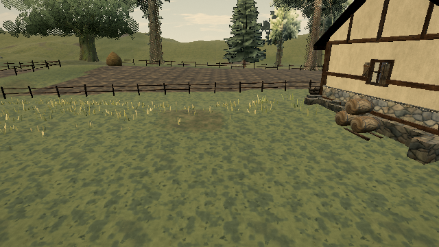

# Cache fixed support rotations

Published reference: [0.0.18 · 421d34b](https://ael-dev3.github.io/Tervain/); tracking [#326](https://github.com/ael-dev3/Tervain/issues/326).

`Terrain.deckAt()` recomputes each authored deck's sine/cosine four times per query. `groundAt()` calls it, then recomputes the archive's fixed rotation twice, including for distant queries. Camera obstruction/terrain clearance repeatedly calls `groundAt()` along the boom and around its clearance volume.

Cache those authored rotations once, retaining the deck specification references and query order. Coordinate arithmetic, boundary comparisons, returned support heights, geometry, and camera rules stay unchanged. These layout rotations are static during play; the cache is rebuilt when the module loads.

## Native replay

```sh
node tools/repro-live-support-rotations.mjs --url https://ael-dev3.github.io/Tervain/ --out support-rotation-proof
npx vitest run tests/presentation/cameraRig.test.ts tests/presentation/terrainTiles.test.ts
npm run build
```

The tool runs the actual before/after query methods on the published Low-preset terrain grid. It samples the world grid, footbridge boundary offsets, and archive surroundings, then drives the native camera and collider queries through 120 fixed 60 Hz follow steps: target x=-2, z=34.6→39.5, yaw through one full turn. This is a scripted camera-follow workload at the walk-fence coordinates, not an input-driven player walk or a complete candidate-build playthrough.

| Measurement | Before | After |
| --- | ---: | ---: |
| Sine/cosine calls during 8,208 ground/deck sample pairs | 82,382 | 302 |
| Sine/cosine calls during 120 native camera-follow steps | 258,398 | 61,694 |
| Exact ground heights and selected deck IDs | identical | identical |
| Complete camera positions, rotations and FOV sequence | identical | identical |
| Frozen native Grade/post software-WebGL pixels | identical | identical |

Counts cover all `Math.sin`/`Math.cos` calls during the measured workload, including unchanged work in other methods. Four one-time cache-initialization calls are excluded. They measure repeated calculations, not elapsed CPU time, total allocations, GPU time or hardware FPS. The remaining calls are expected; other terrain, room and camera calculations are outside this change.

[Receipt with source hash and full-result hashes](../../proofs/support-rotations/report.json).

| Before | After |
| --- | --- |
|  |  |

All 26 focused camera/terrain-tile tests and the production build pass. No asset, layout, visual-style, menu or humor changes. This removes reproduced work from a live query path; it does not establish that the historical 33 ms frames or night/mud hitch are resolved. Hardware play-gate approval remains required.
