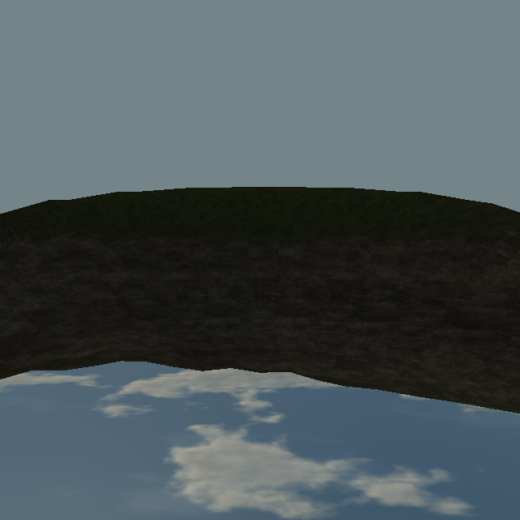
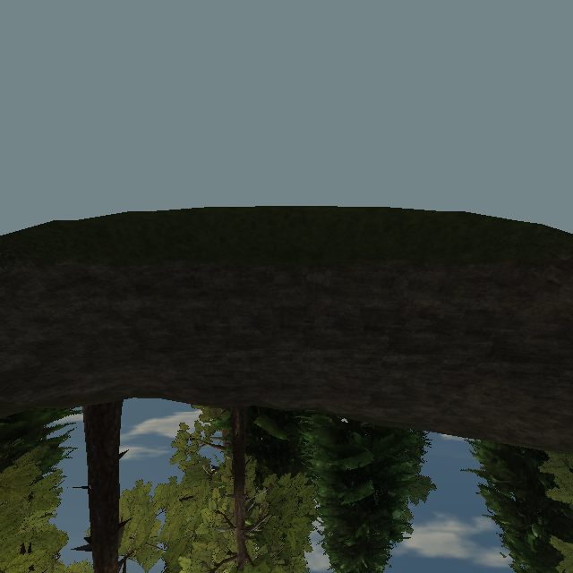
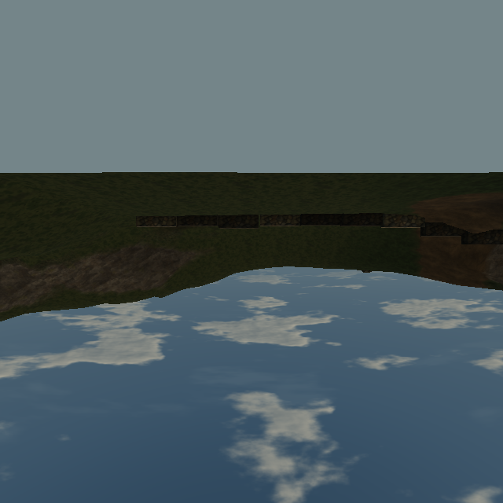
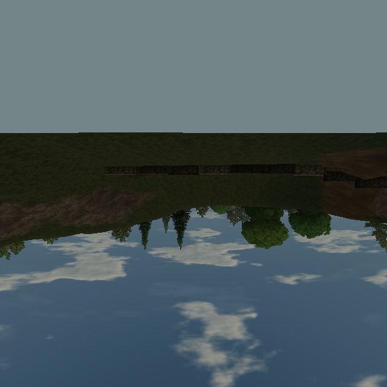

# Trees disappear from window captures when the main camera turns

Reproduced on [Pages](https://ael-dev3.github.io/Tervain/) **0.0.19 · 77c6866**, related to the foliage/pop-in items in [#326](https://github.com/ael-dev3/Tervain/issues/326). Stacked on #627's window-capture scope.

The shrine captures its outside view from the room centre, `(-28, 9.733, -106)`. Turning the main camera at that position should not change this fixed cube. However, forest colour instances are packed only for the main camera's frustum. The capture swaps detail models but never selects trees for its own frustum. The main +Z heading offers the same 157 trees to every cube face; the opposite heading offers only 26. Entire stands disappear from the opposite window view when the player turns.

## Fix

After aiming each cube face, select forest colour instances for that face, then apply the existing middle-detail capture swap. Restore the detail swap and original forest selection after drawing, including render errors. Reuse the normal packing/upload helpers; no new tree geometry, material or shader changes.

Distance selection reads the camera's world matrix: cube faces are children of a translated camera, with local position zero. Keep a matrix snapshot of the last packed main view and its cached shadow frustum so a capture also restores the exact selection when the live camera has moved below the normal refresh threshold. The main refresh cadence and idle-cache policy remain unchanged.

## Matched published-scene replay

[Raw receipt](proofs/tree-window-view/report.json). Medium preset, native 640px cube faces; fixed simulation and shadow map. Grass, forest-floor plants and loose falling leaves are held out to isolate tree selection. Panes are held out of the primary control because their corrected capture is an intended difference. Cube images use cube-face orientation, not the player's camera orientation.

| Window cube face | Before, pixels changed by turning main camera | After |
| --- | ---: | ---: |
| +X | 60,668 | 0 |
| −X | 55,159 | 0 |
| +Y | 56,133 | 0 |
| −Y | 0 | 0 |
| +Z | 12,108 | 0 |
| −Z | 82,508 | 0 |
| Total | **266,576** | **0** |

Both corrected headings and their repeats match pixel-for-pixel. Tree selections after the fix are `110, 185, 20, 0, 155, 25` across the six faces, independent of the main heading. Active matrices, colours, coverage, counts, visibility and bounds restore after every face.

| Primary-view control | Changed pixels | Draw calls before / after | Triangles before / after | Texture objects before / after |
| --- | ---: | ---: | ---: | ---: |
| +Z heading | 0 | 354 / 354 | 4,239,540 / 4,239,540 | 275 / 275 |
| −Z heading | 0 | 45 / 45 | 615,355 / 615,355 | 275 / 275 |

| Before | After |
| --- | --- |
|  |  |
|  |  |

The replay extracts the production `forCapture` / selection-scope code and uses the candidate `WindowView.update` on native published objects. The published forest exposes `update`, not its closure refresh, so a zero-dt adapter invokes that native selection using world-space cube-face proxies. Tests exercise the candidate forest refresh directly, including parented-camera coordinates, nested/idempotent restores and sub-threshold camera drift. The receipt records source hashes and fails if files change during a run.

```sh
node tools/repro-live-tree-window.mjs --url https://ael-dev3.github.io/Tervain/ --out tree-window-proof
npx vitest run tests/presentation/forestCaptureView.test.ts tests/presentation/windowView.test.ts tests/presentation/grassCaptureTiles.test.ts tests/presentation/foliageEngine.test.ts
npm run build
```

27 focused tests and production build pass. The new forest regression fails on the original forest; restoring local-position distance selection fails the parented-camera check, and borrowing the mutable main camera fails the below-threshold restoration check.

This corrects missing capture content and adds selection/restoration work only while a window face is drawn (two selections per face). The primary controls are not a claim of unchanged capture cost. Hardware frame pacing and a normal-play window clip remain unverified; this software receipt does not close tree art quality or the hardware performance gate. Water capture selection is outside this change.
