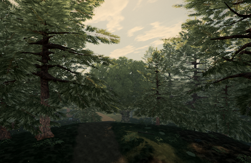

# Near oak clump support: partial Tree32 correction

Published baseline: 0.0.29 · bf9261f. Target `tree:wild:32:27`, oak/hero-oak, world position (-173.934, 0.682, 7.321), uniform scale 1.416488.

The generator's clump gap was in local units while its reach was converted from world metres. After that correction, a separate shape-retention guard still exempted detached clumps when their bounding sphere intersected wood. On the loaded target a six-card group had a centre-to-wood distance of 2.129 m and radius of 2.144 m, despite every tested leaf contact being beyond 1.5 m. A bounding sphere is not proof of leaf contact.

The candidate converts both thresholds and caps the near-LOD radius exemption at wood reach. Cards translate together: no card deletion, rescaling, rotation, new material or shader. Mid and far keep their old behavior. A broader change was rejected because it introduced mid-LOD audit regressions.

| Unmasked rest-geometry audit | Published | Gap-only #683 | Combined candidate |
| --- | ---: | ---: | ---: |
| Tree32 detached cards | 977 | 968 | 962 |
| Tree32 detached groups | 14 | 6 | 5 |
| All 451 near trees: detached cards | 8,928 | 8,889 | 8,869 |
| All 451 near trees: detached groups | 693 | 664 | 655 |

Audit: gap 0.75 m, woodReach 1.5 m, alpha false, maxOperations 300,000,000, all registered targets. These are sampled contact/component flags, not a visual quality score. Five Tree32 groups remain flagged; this does not close the entire tree issue. Mid/far reports and geometry buffers are unchanged; no near tree has more flagged cards or groups. Source template bounding extents retain at least 99.07% on every axis.

## Reproduction and proof scope

Run `node tools/repro-live-tree32-support.mjs --out tree32-proof` from the proof branch while the published baseline is bf9261f. It loads the real live GLBs and all registered targets, runs the actual source factories, applies the same alpha-island repair, and requires every original geometry buffer to match the live baseline before comparing anything. The candidate is applied to native colour/depth/shadow geometries sharing each source position buffer. This is a controlled geometry adapter, not two independently served binary captures.

`proofs/tree32-support/factory.json` records all 30 wood/leaf/LOD buffer hashes and unchanged index counts. `audits.json` records all 451 targets at all three detail levels; `movement.json` records vertex displacement and retained extents. Images use High, hour 15, 492×320 DPR1, fixed camera and frozen time. Wind animation and real hardware frame pacing are not measured.

The regression test fails on the old guard (zero moved groups) and passes on the correction (one detached group becomes supported, shape/indices/UVs/normals preserved and input unchanged). The default radius guard remains covered as an unchanged control.

## Native rendered pairs

| View | Draws before/after | Triangles before/after | Changed pixels |
| --- | ---: | ---: | ---: |
| Tree32 | 297 / 297 | 4,341,736 / 4,341,736 | 12 |
| Tree79 | 460 / 460 | 8,156,248 / 8,156,248 | 332 |
| Tree42 | 292 / 292 | 5,316,719 / 5,316,719 | 21 |

Zero console errors. These are distant contextual views; small changed-pixel counts do not establish that every floating clump is fixed. The operation intentionally changes positions, so these images are not pixel-identical.

## Cost limits

No material/shader, texture sampling, render-pass or per-frame JS changes. The additional guard runs during template construction. All native tree index counts are unchanged. Native paired view submissions above are equal, but the independent compiled-build budget is still required because canopy shading also influences generated grass. Hardware timing and close-up motion/video review remain outstanding.

Validation: 24 focused tests pass, including the failing-before regression and completed-frame/startup fixtures; production build passes. Exact-head compiled geometry inspection and the current main budget gate are running separately; no gate PASS is claimed here yet.

## Alpha-aware cross-check

The same Tree32 near pair was also checked with the live cutout sampler. All 16 distinct UV triangle patterns have positive coarse probes; 169 unique native UV/alpha values cover every probe needed by both geometries. No fine-grid or conservative-hint fallback is needed for this particular pair. The direct transform of the loaded native geometry matches the complete factory candidate's SHA-256, and an independent read-only inspection of the exact compiled candidate verifies all 30 oak wood/leaf/LOD hashes.

| Alpha-mode metric | Before | After |
| --- | ---: | ---: |
| Sampled opaque triangle components beyond wood reach | 3,031 | 2,997 |
| Wood-detached groups of these components | 41 | 40 |
| All opaque triangle components | 12,000 | 12,000 |
| Crown connectivity chunks | 5 | 5 |
| Charged audit operations | 6,449,980 | 6,412,442 |

These alpha-mode counts are **opaque triangle components, not leaf cards**. Many flags remain; no full visual closure is claimed. `alpha-audits.json` and `native-alpha-probes.json` preserve the measurements. Run `node tools/repro-tree32-alpha.mjs --out tree32-alpha-proof` to capture the same native probes and replay both audits; subsequent offline replay accepts `--snapshot tree32-alpha-proof/native-input.json`. The replay rejects a changed published revision, an unmatched geometry hash, an unrecorded probe, or a pattern requiring unrecorded fine sampling. Native capture and offline replay were exercised; the recorded pair produces the table above.
