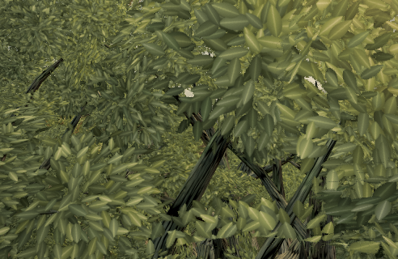

# Tree32 repair omitted from the 0.0.30 release

Live verified at **0.0.30 · 4dd0dae**, including the native build line `v0.0.30 · 4dd0dae · pre-alpha`. Feature head: `f98d45dd0` ([PR #689](https://github.com/ael-dev3/Tervain/pull/689)). This restores the production patch reviewed as #687; it does not introduce a new canopy design.

## Reproduce the integration regression

```sh
git diff --stat 52dd4e3ad 4dd0daeaa
git diff 52dd4e3ad 4dd0daeaa -- src tests
```

The release changes only its decision note and package versions. The second diff is empty. Despite the release description, its `snapDetachedClumps` still has five arguments and the original radius exemption; the converted near-gap call and regression tests are absent. The existing parallel-clump fixture fails on the release source (zero repairs instead of one) and passes with the restored pass. The other fixture, which rejects a move that worsens a member, passes on both. **22 focused tests and production build pass** on this head.

The same release also omits #685/#686. They are reported separately on #688; this PR restores only Tree32's pass.

## Fresh published-build reproduction

Native GLB factory hashes match the live target buffers for all 30 oak wood/leaf/LOD entries. The candidate preserves all card indices, sizes and orientations. Every source X/Z value is bit-identical; both groundcover shade fields are freshly rebuilt and match at **9,409 samples × five variants**. No shade mask is frozen and no grass setting is compensated.

| Near audit, world gap 0.75 m / wood reach 1.5 m | Live 0.0.30 | Restored pass |
| --- | ---: | ---: |
| Tree32 unmasked detached cards | 977 | 973 |
| Tree32 unmasked detached groups | 14 | 10 |
| Tree32 alpha-mode flagged opaque triangle components | 3,031 | 3,024 |
| Tree32 alpha-mode detached groups | 41 | 40 |
| All 451 near targets, unmasked detached cards | 8,928 | 8,895 |
| All 451 near targets, unmasked detached groups | 693 | 671 |

No near target worsens in the unmasked audit; mid/far reports are unchanged. Alpha components are opaque triangle samples, not card counts. Worst sampled gap and full-geometry chunk counts are unchanged. **Substantial crown defects remain**; this is not whole-tree closure or a visual-quality score.

## Matched native renders

[Paired preview](proofs/tree32-release/paired.mp4) · [baseline](proofs/tree32-release/before.mp4) · [candidate](proofs/tree32-release/after.mp4)

High, 492×320 DPR1, hour 15, fixed wind/time, actual `renderWorld` post/MSAA output with forced shadow refresh. Six camera poses orbit the same close-up branch. These are offline rendered camera poses played at 6 fps with half-second holds, **not real-time FPS, an animated-wind test, or a real-key walk**. The restored original exactly matches the first baseline image; zero console errors. This is a controlled production-factory geometry pair on the live scene; the full compiled-build budget is separate.




| Pose | Draws, both | Triangles, both | Changed pixels |
| --- | ---: | ---: | ---: |
| 0 | 258 | 1,787,765 | 224 |
| 1 | 479 | 3,087,944 | 71 |
| 2 | 487 | 3,127,928 | 465 |
| 3 | 492 | 3,232,152 | 1,026 |
| 4 | 492 | 2,999,798 | 609 |
| 5 | 490 | 3,056,753 | 590 |

Local leaf movement intentionally changes pixels. Identity is claimed for the restored control, not for the repair itself. These forced-refresh poses have different costs from the fixed budget preset.

Eight alternating warmed factory batches (five complete oak variants per sample) recorded baseline mean 2,722.3 ms / nearest-rank p95 2,911.3 ms and candidate 2,752.0 ms / p95 3,256.0 ms. They ran alongside the independent gate: these noisy **construction wall times** establish no speedup or frame-time result. The additional search is load-time only; no per-frame callback or helper call is added. Shader/material/texture instructions and render passes are unchanged; fragment invocation count and GPU milliseconds are unmeasured.

## Reproduce the capture

From this proof branch, with the live revision still 4dd0dae:

```sh
node tools/repro-live-tree32-release.mjs --baseline-ref 4dd0daeaa --frames 6 --out tree32-release-proof
npx vitest run tests/presentation/canopySnapReach.test.ts tests/presentation/canopyVerticalGap.test.ts tests/presentation/canopy.test.ts tests/presentation/canopyFlaggedSet.test.ts tests/presentation/canopyDetachedGate.test.ts
npm run build
```

The runner rejects baseline/native geometry disagreement, changed horizontal projection, changed shade samples, unmasked count regressions, changed middle/far reports, invalid render counters, blank images, console errors and a changed restored control. [Raw reports](proofs/tree32-release/report.json), [factory buffers and field checks](proofs/tree32-release/factory.json), [all-target audits](proofs/tree32-release/audits.json), [alpha-mode Tree32 audit](proofs/tree32-release/alpha.json).

The raw report’s scope text inherited the earlier runner’s obsolete bf9261f label. [Source validation](proofs/tree32-release/capture-validation.json) checks all four source hashes against 4dd0dae / f98d45dd0 and records the observed build line; counts and images were not substituted.

[Remaining non-oak birch targets](proofs/tree32-release/birch-targets.json): the fresh near audit still flags 244 cards in 41 groups across 28 birches. A tested vertical-only prototype moved 12 template groups without reducing either count and was rejected. These remain measurement targets, not repaired trees.

## Exact compiled-build budget: PASS

| Max over four completed samples | Live 4dd0dae | Candidate f98d45dd0 | Delta |
| --- | ---: | ---: | ---: |
| Draws | 285 | 285 | 0 |
| Triangles | 3,048,306 | 3,048,306 | 0 |
| Console errors | 0 | 0 | 0 |

`play-gate: PASS f98d45dd0`

Actual exit 0; allowance 0; two same-revision live probes, taking their larger maxima. The producer and sampler are unmodified from the release. [Scrubbed exact-head receipt and tool hashes](proofs/tree32-release/budget.json). Independent read-only inspection of the actual compiled candidate matches all **30** tested factory geometry hashes and its native build line `v0.0.30 · f98d45dd0 · pre-alpha`: [compiled inspection](proofs/tree32-release/compiled.json).

The feature branch contains only the original four-file production/test restoration. These proof files live on a separate evidence branch and do not change the gated feature head. Hardware visual approval remains with the reviewer; no merge or main push was performed.
