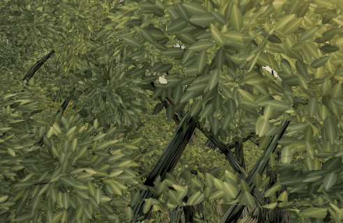

# Tree32 near support: projection-preserving revision

Feature commit `cb7603817eac3d77a6445dc25232b76f87eba134`; published baseline **0.0.29 · bf9261f**. Target `tree:wild:32:27`, oak/hero-oak, world (-173.934, 0.682, 7.321), scale 1.416488.

## Change and limits

A clump's bounding sphere can intersect wood even when its leaf surfaces exceed wood reach. Near detail now checks untouched clumps again with the audit's converted 0.75 m gap. It accepts only vertical translations that strictly improve every member's sampled wood distance. Existing placements and the earlier layout pass stay in place. The residual pass reuses the existing components, contact results and wood-search index.

No cards are removed, resized or rotated. The near shade-input X/Z coordinates remain bit-identical. Both shade fields are freshly rasterized from their own geometry: **9,409 samples per variant, five variants, all identical**. No shade mask is frozen, density compensated, or grass setting changed. Mid/far geometry and reports are unchanged. All 451 near targets have no unmasked detached-card/group regression.

| Tree32 rest-geometry audit | Live | Candidate |
| --- | ---: | ---: |
| Unmasked detached cards | 977 | 973 |
| Unmasked wood-detached groups | 14 | 10 |
| Alpha-mode flagged opaque triangle components | 3,031 | 3,024 |
| Alpha-mode wood-detached groups | 41 | 40 |

Gap 0.75 m, woodReach 1.5 m, cap 300,000,000 operations. The alpha pass uses the actual native cutout sampler. Alpha components are sampled opaque triangles, **not leaf cards**. Remaining flags are substantial; this does not close Tree32 or establish a visual-quality score. Worst sampled gap and alpha connectivity chunk count remain unchanged. All-near unmasked totals: 8,928/693 cards/groups → 8,895/671.

## Native proof

Run `node tools/repro-live-tree32-vertical.mjs --out tree32-proof --frames 6` from this proof branch while live remains bf9261f. The original factory's 30 wood/leaf/LOD buffer hashes must match live. Before/after factories use their actual production source files; every candidate buffer matches an independent read-only inspection of the exact compiled feature build.

The capture uses High, hour 15, 492×320 DPR1, actual `renderWorld` post/MSAA output, forced shadow refresh, fixed time and wind phase. Six matched camera poses orbit a close-up branch. The restored original is pixel-identical to the first baseline frame; zero console errors. This is a controlled geometry adapter, not two separately served image runs. Unlike the earlier held head, the rebuilt shade-input field is identical; the separate full compiled-build gate also passes.

[Paired motion preview](proofs/tree32-vertical/paired.mp4) · [baseline](proofs/tree32-vertical/before.mp4) · [candidate](proofs/tree32-vertical/after.mp4)

The preview plays six offline rendered poses at 6 fps with half-second holds. It is **not real-time FPS, a real-key walk, or an animated-wind test**. No hardware or Apple frame-time claim.

| Pose | Draws before/after | Triangles before/after | Changed pixels |
| --- | ---: | ---: | ---: |
| 0 | 258 / 258 | 1,787,765 / 1,787,765 | 224 |
| 1 | 479 / 479 | 3,087,944 / 3,087,944 | 71 |
| 2 | 487 / 487 | 3,127,928 / 3,127,928 | 465 |
| 3 | 492 / 492 | 3,232,152 / 3,232,152 | 1,026 |
| 4 | 492 / 492 | 2,999,798 / 2,999,798 | 609 |
| 5 | 490 / 490 | 3,056,753 / 3,056,753 | 590 |

These poses force shadow refresh; their costs are separate from the gate's fixed forest preset. Position changes intentionally affect pixels; pixel identity is claimed only for the restored control.

## Exact compiled-build budget

| Max over four completed samples | Live bf9261f | Candidate cb7603817 | Delta |
| --- | ---: | ---: | ---: |
| Draws | 285 | 285 | 0 |
| Triangles | 3,048,306 | 3,048,306 | 0 |
| Console errors | 0 | 0 | 0 |

Two same-revision live probes; head matches; allowance 0; actual exit 0. The current-main producer and completed-frame sampler are unmodified; their hashes and scrubbed receipt are in `budget.json`.

`play-gate: PASS cb7603817`

Materials, shader source, texture sampling instructions per fragment and render passes are unchanged. Total fragment invocations and GPU frame time are unmeasured. The changed helper runs during template construction; no per-frame code path or callback was added.

Eight alternating fresh-factory construction pairs, five complete oak variants per sample, after two warm-ups per mode, recorded wall times under concurrent budget activity: baseline mean 3,165.2 ms / p95 3,838.2 ms; candidate mean 3,002.6 ms / p95 3,871.0 ms. Raw samples are in `report.json`. These are noisy **construction timings**, not per-frame CPU, an Apple result or evidence of a speedup.

30 focused tests and production build pass. Regressions cover the original sphere false exemption, preserved shape/index/UV/normal data, immutable input, exact X/Z and rebuilt shade agreement, near-only converted gap, unchanged default/mid path, and rejection of a move that worsens another member's wood gap. Hardware, animated-wind and whole-tree visual approval remain outstanding.

## Native all-oak alpha cross-check

Independent native audits of the published baseline and compiled candidate cover 52 oaks with identical target transforms and cutout samplers. Flagged opaque components fall **20,527 → 20,448**, groups **1,482 → 1,466**; 610,292 total components and 59 full-geometry chunks stay unchanged. Comparing component IDs finds **zero newly flagged components** on every tree. These are opaque triangle components, not card counts.

One target, `tree:wild:68:13`, changes 1,742/41 components/groups → 1,740/42. Its two newly supported components disappear from the audit’s far-only graph. Re-running that graph with the original boxes and candidate far mask gives exactly the same 42 partitions: this count increase does not indicate newly detached components or changed spatial connections among the remaining components. See [scrubbed per-tree results](proofs/tree32-vertical/all-oak-alpha.json).
