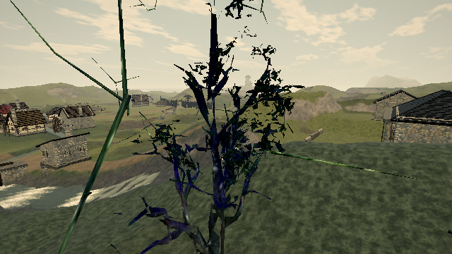

# Bounded bark-attribute search while building canopy supports

Published baseline: [0.0.18 · 421d34b](https://ael-dev3.github.io/Tervain/). Related tree/foliage feedback: [#326](https://github.com/ael-dev3/Tervain/issues/326). This addresses CPU work while constructing the supporting twigs; it does not resolve the remaining canopy art-quality feedback.

Each twig inherits UVs, colours and other attributes from the nearest original wood vertex. The original implementation searches the complete trunk vertex buffer for every twig. For plans with at least 32 twigs, the candidate groups source vertices into one-metre cells. It checks the closest cell first, then every other cell whose squared-distance bound can still beat or tie the best vertex. Equal distances still choose the lowest original index. Smaller plans keep the original scan to avoid index-building overhead.

## Matched live-template result

Fourteen unique twig-bearing templates, 1,236 twigs:

| Metric | Original | Candidate |
| --- | ---: | ---: |
| Full squared-distance evaluations | 9,150,606 | 392,529 |
| Cell-distance bounds | 0 | 212,207 |
| Sum of per-template warm median construction time | 169.6 ms | 74.1 ms |
| Draw calls in captured path | 246 | 246 |
| Triangles in captured path | 1,426,944 | 1,426,944 |
| Changed image channels | — | 0 |

Every vertex attribute and index matches the native buffers. The wood changes 72,424 image channels relative to the empty-mesh control, confirming that it is visible. Timing is five alternating samples per template, including index and output construction; individual samples vary and this is not a full-world load-time or FPS claim. The grid is temporary build-time storage, not a heap-saving claim.

## Reproduction and verification

```sh
node tools/repro-live-twig-bark-search.mjs --out twig-search-proof
node tools/repro-live-twig-bark-search.mjs --candidate-ref d790c277f --out twig-search-control
npx vitest run tests/presentation/twigBarkSearch.test.ts tests/presentation/canopy.test.ts --testTimeout=90000
npm run build
```

The first command must pass; the original-source control must fail its strict work-reduction assertion. Both use software WebGL by default. The tool reconstructs every unique near/middle wood template in the live Low-preset fixture that retains a twig plan, using its original attribute/index prefix. Before and after outputs must both match every native attribute and index byte. Timed samples include grid building and output construction; they are software-browser samples, not full-load or hardware frame-time measurements.

A separate rendered check uses a native wood material and placement, with one controlled white instance tint, through the native post-render path. An empty-mesh control must differ, so invisible probes cannot pass by comparing identical background images. Draw calls and triangles must match before/after.

Results and source hashes: [receipt](proofs/twig-bark-search/report.json). Original-source negative control: [control](proofs/twig-bark-search/control.json).

| Before | After |
| --- | --- |
|  |  |

Thirteen targeted tests and the production build pass. The regression fails on the original implementation. Hardware play-gate and full-world load/frame-time improvements remain unverified; no claim that foliage quality or the 60 fps target is closed.
