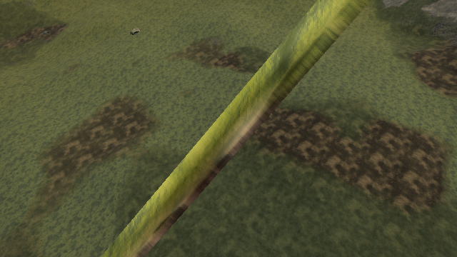

# Generated twig UV and normal-map frame

Baseline: [published 0.0.18 · 421d34b](https://ael-dev3.github.io/Tervain/), related bark/foliage feedback in [#326](https://github.com/ael-dev3/Tervain/issues/326).

`growTwigs` generated UV U around a twig and decreasing V along its length, but wrote the longitudinal direction into the tangent attribute with positive handedness. Three uses that attribute for tangent-space normal maps. The live fixture contains three twig-bearing templates with both tangents and normal maps; the original generated frame is about 90 degrees off the ring's U direction and has reversed handedness.

Use the projected circumferential U direction and negative handedness. A tangent-bearing ring also duplicates its seam vertex so its closing face advances U instead of interpolating backwards. This adds vertices, not triangles or a new silhouette. Existing trunk attributes and all per-triangle positions, normals and colours remain unchanged. Templates without tangents retain their original buffers. Textures, material parameters and tree shapes are retained.

## Matched live result

| Metric | Original | Corrected |
| --- | ---: | ---: |
| Normal-mapped twig-bearing templates | 3 | 3 |
| Generated vertices in these templates | 768 | 1,024 |
| Mean U-direction error | ~90° | <0.0014° |
| Maximum U-direction error | 104.11° | 0.0109° |
| Wrong-handed vertices | 768 | 0 |
| Reversed closing UV edges | 256 | 0 |
| Captured draw calls / triangles | 27 / 127,607 | 27 / 127,607 |

The candidate matches the geometric derivative-reference image exactly. Original versus corrected changes 48,100 image channels; disabling the normal map changes **0** channels between the same two non-seam face captures. Original reconstruction also matches the native image exactly. The 256 extra seam vertices do not add triangles or alter any triangle's position/normal/colour. All original wood-vertex prefixes match, and all eleven templates without tangents retain byte-identical buffers.

## Verification

```sh
node tools/repro-live-twig-tangent-frame.mjs --out twig-frame-proof
node tools/repro-live-twig-tangent-frame.mjs --candidate-ref 71074891e --out twig-frame-control
npx vitest run tests/presentation/twigTangentFrame.test.ts tests/presentation/twigBarkSearch.test.ts tests/presentation/canopy.test.ts --testTimeout=90000
npm run build
```

The first command must pass; the original-source control must fail. The tool reconstructs every native twig-bearing near/middle wood template in the Low-preset fixture. The original reconstruction must match all native buffers. For the candidate it compares every original vertex prefix and hashes the indexed positions, normals and other non-UV/non-tangent attributes, so seam duplication cannot hide a shape change.

The independent frame reference projects the ring's geometric U derivative onto its stored normal and checks handedness against decreasing longitudinal V. The audit also counts reversed closing UV edges. Software-WebGL macro captures use one actual normal-mapped, non-seam twig face, its native wood material and post-render path, with a controlled white instance tint. The no-normal-map control must remain pixel-identical, isolating the normal-map frame from bark albedo or lighting changes. This is a shader/UV correctness receipt, not a full-tree quality score or hardware frame-time measurement.

[Result](proofs/twig-tangent-frame/report.json) · [original-source negative control](proofs/twig-tangent-frame/control.json)

| Original | Corrected |
| --- | --- |
|  |  |

Fifteen targeted tests and the production build pass. The frame regression fails on the original implementation. Hardware play/video gating remains pending; this does not close the remaining crown shape, giant-tree or root feedback.
