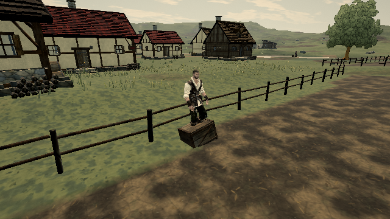
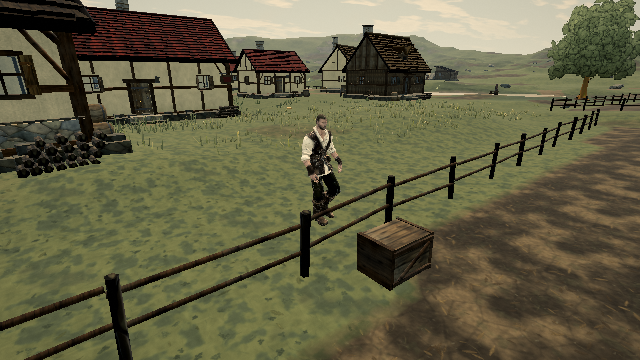

# Fence vault clearance against loose cargo

Live reproduction: https://ael-dev3.github.io/Tervain/ (0.0.16 · 9ab40b3).

A scripted vault checks static scenery but bypasses ordinary movement collision with loose rigid bodies. Move a crate to a fence's landing point, approach the rail and press jump: the hero crosses into the crate, then pops upward at the end of the arc.

The fix sweeps a capsule along the existing 20 arc segments against current loose-body positions before accepting the vault. Conservative padding encloses the sine/smoothstep curve between samples. An obstructed arc falls back to the existing ordinary jump; it does not change the vault height, landing point, or visuals. This preflight does not cover cargo newly entering the arc after the vault starts.

| Native compiled-game check | Before | After |
| --- | ---: | ---: |
| Clear field approaches accepted | 60 / 60 | 60 / 60 |
| Crate-blocked landing accepted | yes | no |
| Maximum capsule penetration into crate | 0.365955 m | 0 m |
| Frames penetrating crate by over 0.02 m | 6 | 0 |
| Nearby crate outside the arc blocks vault | no | no |

The 60 clear approaches cover three authored field-fence orientations, both sides, walk/run input and five relative angles (−75°, −45°, 0°, 45°, 75°). The game performs the actual approach and jump through keyboard input. Each crossing advances native player and rigid-body simulation at 1/60 s. The obstructed case uses a native dynamic crate restored at the planned landing and measures Rapier's capsule contact distance each step. Nearby cargo is displaced two metres along the fence, rather than toward the player.

Before uses the published 9ab40b3 program/assets transported through a sandbox-only mirror with standard HTTPS certificate verification, with commit-pinned model URLs mapped to the same verified transport. Origin differs from Pages. After uses a production build of this branch. Both use the native hero and SwiftShader at 640×360/low quality; world clock and NPC updates are held stationary to isolate the collision. This is deterministic collision evidence, not a Mac frame-time or hardware play-gate PASS.

[Before receipt](vault-cargo/before.json) · [After receipt](vault-cargo/after.json)




## Repeat against compiled builds

Serve each production build and run:

```sh
node tools/repro-vault-cargo.mjs "$TERVAIN_URL" before before
node tools/repro-vault-cargo.mjs "$TERVAIN_URL" after after
```

Use the baseline URL for the first command and candidate URL for the second. The script asserts native hero presence, 60 successful unobstructed approaches, nearby-cargo clearance and expected blocked-landing behavior. It writes full per-step numerical receipts and a screenshot at the baseline's worst-contact step. `REPRO_INIT_FILE` optionally supplies a sandbox transport initialization script; no TLS-verification bypass is used or required by the repro.

Validation: 92 focused physics, locomotion and swimming tests pass; production build/typecheck pass. Hardware play gate remains required before treating the PR as ready to ship.
