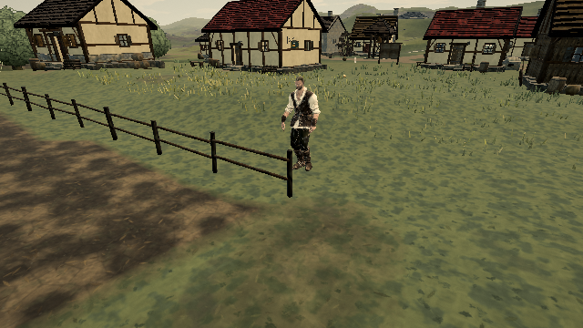
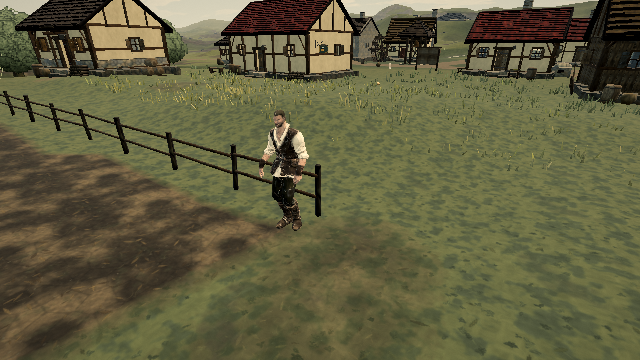

# Fence end-post jump failures

Baseline: [published 0.0.18 · 421d34b](https://ael-dev3.github.io/Tervain/). Related checklist: [#326](https://github.com/ael-dev3/Tervain/issues/326).

## Reproduce

Walk or run normally toward either side of an open field-fence end, aiming 10 cm inside the end post, and press Jump. The player jumps in place against the fence instead of vaulting. Moving another 10 cm inward makes the same fence vaultable. One witnessed jump position is approximately `(15.8, 1.3, 52.3)`; the receipt records every exact position.

The planner excluded the final 15 cm of every segment. This disagreed with the player's 40 cm collision radius: the body could hit a post where the planner refused to cross it. The same issue occurs with the player's centre slightly beyond the segment end.

Allow vault planning wherever the capsule footprint overlaps the end post. Keep facing, reach, terrain, landing, neighbouring-fence and cargo checks. Outside the footprint, Jump still uses the ordinary jump.

This is stacked on #475's rail-clearance arc. An eligibility-only attempt exposed another necessary safety condition: a fixed 20% takeoff phase can begin crossing before the feet clear a tall rail. The candidate finds a safe symmetric travel interval from the existing vertical arc and uses it in both planner and executor, including the sweep curvature allowance. It preserves the existing apex, landing target and total duration. Horizontal travel is concentrated into a shorter interval; gameplay review is still required.

## Matched build replay

```sh
node tools/repro-live-vault-end-posts.mjs --out vault-end-proof
npx vitest run tests/presentation/playerMotion.test.ts tests/presentation/physicsScout103.test.ts tests/world/colliders.test.ts --testTimeout=90000
npm run build
```

The script loads the published scene and hero, sends real Forward/Sprint/Jump binding events and advances the native controller and physics at 60 Hz. It checks four native field-fence endpoints, both sides, walk/run, and two offsets: 10 cm inside and 15 cm beyond the end. That gives 32 cases per variant. It first runs the unmodified live controller, then swaps only the baseline/candidate planner and executor methods. Both comparison variants include #475; its source is pinned in the tool. Terrain, collisions, bindings and the rendered rig remain from the published world.

The rail contact check uses Rapier with a full-height player capsule and the selected native rail's oriented bounds, excluding only the extra invisible fence-wall lift. Per-frame positions and signed contact distances are retained. Screenshots use the game's renderer and a fixed view of the same crossing. This is software-WebGL evidence, not Mac FPS or a hardware gate.

If the browser cannot verify the public site's certificate authority, a temporary mirror can fetch the published assets through verified HTTPS. TLS verification and the game's checksums remain enabled.

## Results

| Measure | Live | #475 baseline | Candidate |
| --- | ---: | ---: | ---: |
| Cases | 32 | 32 | 32 |
| Vaults accepted | 0 | 0 | 32 |
| Crossings | 8 | 8 | 32 |
| Grounded at finish | 32 | 32 | 32 |

Eight sprint approaches beyond the post can round it without vaulting; the remaining **24 fail to cross**. The fix must be assessed by actual crossings, not acceptance counts alone.

The candidate has no sampled rail overlap (minimum reported signed distance 0.00009614 m). An eligibility-only negative control crossed all 32 but produced eight deep-overlap frames, worst 5.61 cm, on a tall native rail. It is rejected; the safe timing is part of the submitted fix.

Regression coverage includes 648 slope/orientation/side/end/offset/speed cases, ordinary jumps beyond the body footprint, blocked landings, and tall-post timing at 240 Hz. The full selected suite passes **77 tests** and the production build passes. Restoring the old eligibility fails both new walk/run tests; retaining only the eligibility change fails the new clearance timing test.

The [receipt](proofs/vault-end-posts/report.json) contains the source hashes and case summaries; its linked, checksum-pinned `frames.json.gz` preserves all per-frame data. Decode it with `gzip -dc frames.json.gz`. This closes the witnessed endpoint dead zone, not all fence or movable-obstacle combinations. Hardware play-gate verification remains outstanding.



