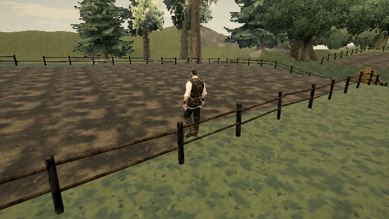

# Fence-vault landing momentum

Published reference: [0.0.18 · 421d34b](https://ael-dev3.github.io/Tervain/); tracking [#326](https://github.com/ael-dev3/Tervain/issues/326).

## Repro and cause

Face an authored field fence within vault reach. Press jump with no movement direction held, let the vault finish, and keep movement released. The hero reaches the selected landing and then slides farther forward without input.

`stepVault` uses a smoothstep horizontal path, whose derivative is zero at landing. During the arc it stores average crossing speed in `vx`/`vz`. At completion it cleared only vertical velocity. The next grounded updates therefore integrated this leftover horizontal speed as ordinary inertia and carried the hero beyond the checked landing.

The fix clears all three velocity components at completion. The selected landing, arc, duration, clearance checks, and ordinary movement code are unchanged. New directional input resumes through the existing grounded acceleration.

## Verification

```sh
node tools/repro-live-vault-landing-momentum.mjs --url https://ael-dev3.github.io/Tervain/ --out vault-momentum-proof
npx vitest run tests/presentation/playerMotion.test.ts
npm run build
```

The reusable published-build tool uses the native controller, context, physics stepping, authored rail, and logical jump input followed by released movement. It borrows only the candidate's actual `stepVault` method for the after intervention; this is not a complete candidate-build playthrough. Both sides use the same 30/60/120 Hz steps, three takeoff distances, and both fence sides (18 matched cases).

| Measurement | Before | After |
| --- | ---: | ---: |
| Maximum unintended travel in one second after landing | 0.193361 m | 0 m |
| Matched vault paths | identical | identical |
| Grounded at landing | 18/18 | 18/18 |

The new regression fails on the baseline at each tested cadence. All 63 player-motion tests pass with the fix, including the 27 cadence/distance/orientation combinations in the new tests; TypeScript and production build pass.

[Native receipt](../../proofs/vault-landing-momentum/report.json); [complete path records](../../proofs/vault-landing-momentum/paths.json.gz).

Fixed-camera software-WebGL captures through the native Grade/post path, one second after the same 60 Hz landing:

| Before | After |
| --- | --- |
|  |  |

Distances and exact path comparisons are the assertions; these stills show the replay context. They do not prove every fence approach, hardware performance, or production visual quality. Hardware play-gate approval is still required. No asset, menu, or art-style changes.
