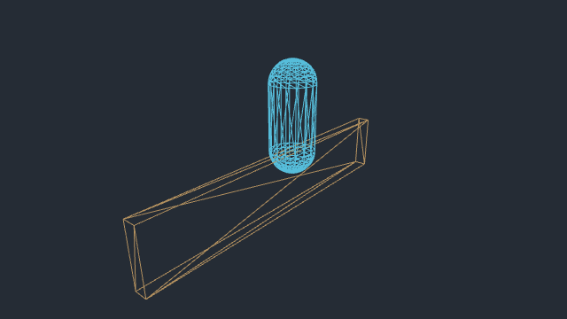
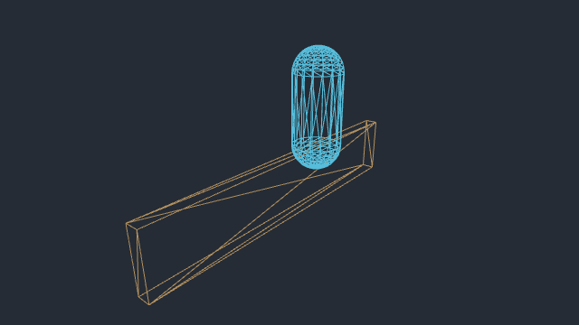

# Fence vault rail clearance

Baseline: published 0.0.18 · 421d34b at https://ael-dev3.github.io/Tervain/.
This isolates the published controller source and the production capsule dimensions in a native browser fixture; it is not a timed replay of the whole live world.

## Reproduction

```sh
node tools/repro-vault-slope.mjs --baseline 421d34b --out vault-slope-proof
npx vitest run tests/presentation/playerMotion.test.ts
```

The fixture loads the delivered hero rig, invokes the actual `Player` vault planner/executor, and checks the body with Rapier `contactShape` throughout every accepted crossing. The screenshots show the diagnostic capsule, not the hero animation. Baseline source is loaded directly from the specified Git revision without modifying the checkout.

Matrix: approach distances 0.53, 0.55, 0.8, 1.1, 1.5, 1.8 and 1.9 m; landing height differences −0.59, −0.55, 0, +0.55 and +0.59 m; fence rotations 0°, 45° and 90°; simulation sampling at 60 and 240 Hz. A 1.1 m rail uses the existing 0.6 m artificial collision-wall extension. The capsule radius is 0.4 m and total height 1.95 m.

| Result | Published source | Candidate |
| --- | ---: | ---: |
| Accepted/grounded crossings | 210/210 | 210/210 |
| Crossings penetrating the rail by more than 5 mm | 192 | 0 |
| Deepest penetration | 0.2901 m | 0 m |
| Final ground-height error | 0 m | 0 m |
| WebGL errors | 0 | 0 |

The existing arc starts horizontal travel while the capsule is still rising beside the rail. It can intersect the rail even on flat terrain. On slopes, subtracting the higher endpoint from the sine amplitude also places the midpoint below the intended peak: the linear base at the midpoint is the endpoint **mean**.

The candidate reserves the first and last 20% of the vault for vertical takeoff/landing and performs smooth horizontal travel in the middle 60%. It uses the endpoint mean for the vertical amplitude in both planning and execution. The swept-prop curvature allowance is increased for the shortened horizontal travel phase. Reach, landing location and total vault duration remain the same.

[Complete before/after rows](proofs/vault-slope-clearance/report.json).

For the 1.8 m downhill approach, the images compare the same normalized time: the baseline's deepest rail contact. Blue is the capsule and tan is the rail.

| Published controller | Candidate controller |
| --- | --- |
|  |  |

## Limits and review

This is sampled capsule contact coverage for the stated rail and slope matrix, not a continuous proof for every fence geometry. It does not test input timing at walk/run speed, moving cargo, NPC obstructions or the full-world animation/camera view. Those require the gameplay gate. Concentrating horizontal travel increases its peak speed within the unchanged vault duration; review the resulting motion in real play before shipping. No hardware frame-time or M5 performance result is claimed.

The mud/water boundary hitch remains a separate investigation. Retarget pose yielding and temporary-array removal have deterministic source-level receipts, but do not establish that the full recorded crossing hitch is fixed.
