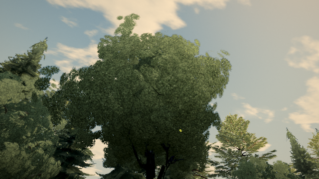
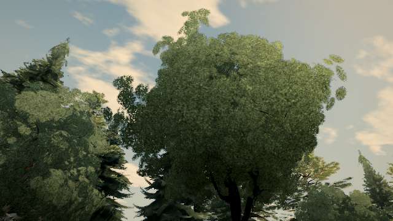
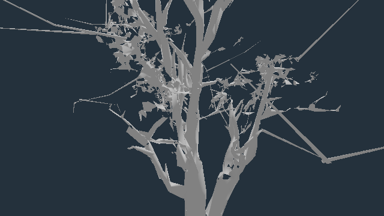
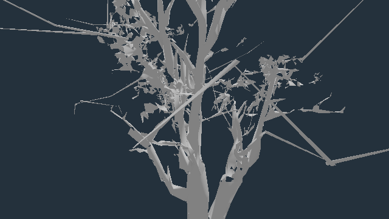
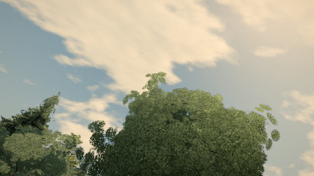
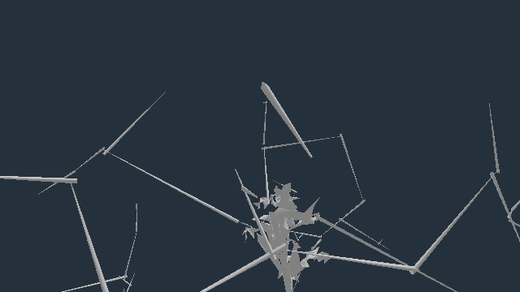
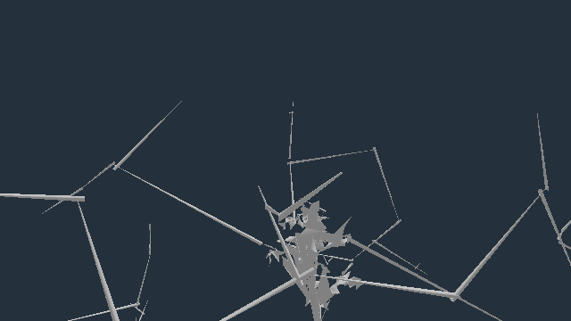

# Verdant source-oak graft contact

Baseline: published 0.0.33 · b317734. Candidate: f0c33cda6, stacked on #698 (and its #696 helper).

The near `oak/verdant-sentinel` template retains three twig origins outside preceding wood. Example instance `tree:wild:70:35`, foot (62.326, 0.668, 56.799), scale 1.18123. These are twig origins in the crown, not trunk-ground roots or three different trees. The wood material is opaque; this diagnosis does not depend on sparse leaf-alpha samples.

| Twig | Baseline root-centre distance to other wood (template units) | Candidate | First stem segment crosses preceding wood |
| --- | ---: | ---: | --- |
| 95 | 0.312778 | 0.033209 | no → yes |
| 109 | 0.826048 | 0.039769 | no → yes |
| 112 | 0.658740 | 0.008169 | no → yes |

Centre distances are not signed surface gaps. The independent intersection test uses actual indexed triangles, excluding the twig itself and later twigs. Twig 95 has only two rings: checking its whole stem also fails before the narrower repair; a shorter distance alone was not accepted as proof.

The existing helper's 0.12 template-unit allowance leaves twig 95 separated. This template opts into 0.04; other templates retain the default. Five origins move (92, 95, 97, 109, 112). The two adjacent grafts are explicitly included in the scope: 92 acquires a centreline crossing, while 97 already crossed and retains its crossing. No claim that all five were floating. Source wood/collision prefix, indices, tips, leaf buffers and non-position/normal/UV/tangent attributes are preserved. Middle/far buffers remain unchanged in the fixture.

## Rendered evidence

[Native scene report](proofs/verdant-oak-roots/native/report.json), [road fixtures and world coordinates](proofs/verdant-oak-roots/road-views.json), [model contacts](proofs/verdant-oak-roots/model-contacts.jsonl).

| Aimed twig | Whole-image changed pixels | Changes within central 101×101 region | Draws before/after | Triangles before/after |
| --- | ---: | ---: | ---: | ---: |
| 95 | 164 | 103 | 190 / 190 | 2,079,402 / 2,079,402 |
| 109 | 81 | 8 | 196 / 196 | 2,162,156 / 2,162,156 |
| 112 | 91 | 10 | 171 / 171 | 1,892,219 / 1,892,219 |

All three restored native RGB controls match exactly; zero console errors; player and camera collider checks pass. These are native High post/MSAA scenes with a session geometry swap, frozen rest wind, authored-road player positions and separate inspection cameras. Foliage obscures parts of the joins. Changes in a target rectangle do not prove the entire stem is visible or improve the whole crown's quality.

| Twig | Native before | Native candidate | Isolated wood before | Isolated wood candidate |
| --- | --- | --- | --- | --- |
| 95 |  |  |  |  |
| 109 |  |  |  |  |
| 112 |  |  |  |  |

The isolated views deliberately use neutral material, custom lighting, no leaves/actors/wind/post. They establish geometry changes, not game appearance or visibility. Each is one draw / 8,912 triangles, with exact restored controls and zero errors.

## Reproduce

```sh
npx vitest run tests/presentation/verdantOakRootContact.test.ts tests/presentation/sourceOakRootContact.test.ts tests/presentation/heroTwigRootContact.test.ts tests/presentation/twigRootContact.test.ts tests/presentation/canopyBaseline.test.ts tests/presentation/canopySnapReach.test.ts
node tools/repro-source-oak-root-contact.mjs --kind oak/verdant-sentinel --root-tolerance 0.04 --paths docs/perf/proofs/verdant-oak-roots/road-views.json --out verdant-native
node tools/repro-verdant-oak-wood-diagnostic.mjs verdant-diagnostic docs/perf/proofs/verdant-oak-roots/road-views.json
node tools/inspect-verdant-oak-geometry.mjs verdant-live.json
```

Twenty focused tests and production build/type-check pass. The same regression with the narrower tolerance removed fails the segment-contact requirement. This does not close all leaf-island reports or establish animated-wind contact, hardware frame pacing, or heat improvement. [Compiled native geometry comparison](proofs/verdant-oak-roots/compiled-comparison.json) confirms all three LOD leaf buffers match live exactly, compiled wood equals the browser-session repair, and middle/far wood stays byte-identical. Reapplying the repair is byte-idempotent. The exact-head stock budget is still pending; no PASS is claimed until completion.

## Construction cost

[Alternating-order four-pair Node study](proofs/verdant-oak-roots/construction-cost.json), rerunnable with `npx vitest run tests/presentation/verdantLoadStudy.test.ts` on this proof branch. The first pair is cold. The two helper calls together cost 51.0 ms cold and 26.9–32.8 ms in the three subsequent runs. This is added template-construction work, not zero-cost loading. Whole-factory timings vary substantially; their difference is not presented as a measured browser loading regression or saving. No new code executes during frame updates.
