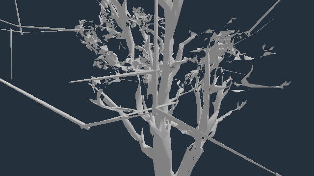

# Verdant source-oak short-graft contact

Baseline: published 0.0.33 · b317734. Current candidate: **52d4a5f4c**, stacked on #698 and its #696 helper. Earlier broad-repair captures and measurements are superseded.

## Reproduced defect and repair

Near `oak/verdant-sentinel` twig 95 is disconnected from preceding wood. Example instance `tree:wild:70:35`, tree foot (62.326, 0.668, 56.799), scale 1.18123; the original twig origin is at (63.968, 9.715, 50.232). This is a crown twig origin, not a trunk-ground root. The wood material is opaque.

| Model check | Before | Candidate |
| --- | ---: | ---: |
| Twig 95 root-ring centre distance to other wood, template units | 0.312778 | 0.011662 |
| First stem centreline segment crosses a preceding actual wood triangle | false | true |
| Twig origins changed | — | only 95 |
| Origins over the existing 0.12 template-unit flag threshold | 3 | 2 |
| Near wood / leaf triangles | 8,912 / 10,772 | unchanged |

Centre distances are not signed surface gaps. The intersection check excludes self and later twigs. Every other twig, every tip, source/collision prefix, indices, leaf buffer and non-position/normal/UV/tangent attribute is unchanged. Middle/far wood remains byte-identical. [Model receipt](proofs/verdant-oak-roots/model-contact.json), [compiled native hashes](proofs/verdant-oak-roots/compiled-comparison.json): all three LOD leaf buffers match live, compiled wood matches the session repair, and repeating the repair is byte-idempotent.

The thin graft requires a 0.04 template-unit tolerance. A 0.5-unit maximum move restricts the opt-in to that short defect; other templates keep their existing defaults. Long origins 109 and 112 remain unrepaired. The broader attempt moved those and two adjacent grafts: it improved root contact but raised near alpha-aware flags on the pictured instance from 692 to 698. Dense sampling recovered three positive contacts, while three triangles still sampled beyond 1.5 world metres. That result was held rather than overridden by a passing draw budget. [Rejected broad audit](proofs/verdant-oak-roots/rejected-wide-canopy.json), [dense follow-up](proofs/verdant-oak-roots/rejected-wide-dense.json). Sampling alone cannot prove continuous absence of support.

## Canopy support regression check

All **four registered instances** of this template, gap 0.75 m, wood reach 1.5 m, near/middle rest geometry. Each scan completes. [Raw paired audit](proofs/verdant-oak-roots/canopy-contacts.json).

| Detail / audit mode | Detached cards before / after | Detached clumps before / after |
| --- | ---: | ---: |
| Near, unmasked | 718 / 718 | 58 / 58 |
| Near, alpha-aware | 2,614 / 2,614 | 148 / 148 |
| Middle, unmasked | 1,807 / 1,807 | 3 / 3 |
| Middle, alpha-aware | 4,740 / 4,740 | 6 / 6 |

These diagnostic sample counts are not continuous distances or a global foliage clearance. This one-graft repair does not reduce those leaf-card counts or close the remaining canopy issues.

## Rendered evidence

The refreshed native capture is pending its final identity check; its partial run is not a clean completion receipt. Exact-head stock budget on 52d4a5f4c is also running. No current-head PASS is claimed yet.

The completed [isolated-wood diagnostic](proofs/verdant-oak-roots/diagnostic/report.json) deliberately uses neutral material, custom lighting, no leaves/actors/wind/post. It establishes geometry change, not native game appearance or visibility. One draw / 8,912 triangles before and after, exact restored pixels, zero console errors.

| Diagnostic before | Diagnostic candidate |
| --- | --- |
|  |  |

## Reproduce

```sh
npx vitest run tests/presentation/verdantOakRootContact.test.ts tests/presentation/sourceOakRootContact.test.ts tests/presentation/heroTwigRootContact.test.ts tests/presentation/twigRootContact.test.ts tests/presentation/canopyBaseline.test.ts tests/presentation/canopySnapReach.test.ts
node tools/repro-source-oak-root-contact.mjs --kind oak/verdant-sentinel --root-tolerance 0.04 --max-root-move 0.5 --paths docs/perf/proofs/verdant-oak-roots/road-views.json --out verdant-native
node tools/repro-verdant-oak-wood-diagnostic.mjs verdant-diagnostic docs/perf/proofs/verdant-oak-roots/road-views.json
node tools/inspect-verdant-oak-geometry.mjs verdant-live.json
node tools/inspect-verdant-oak-canopy.mjs verdant-canopy.json
```

Twenty focused tests and production build/type-check pass. No new update/shader code, topology or buffer lengths. No hardware frame-time, heat or animated-wind-contact claim. The original uncapped head's stock budget passed with 285 draws / 3,048,306 triangles, equal to live, but that does not authorize the broader geometry or count as a current-head receipt.

[Construction-only Node study](proofs/verdant-oak-roots/construction-cost.json), rerunnable via `tests/presentation/verdantLoadStudy.test.ts` on this proof branch. Two helper calls add 107.9 ms cold and 22.6–81.1 ms in the three subsequent runs while other checks run. These variable lab timings are not a browser load-time or hardware performance verdict. There is added construction work and no additional frame-update work.
