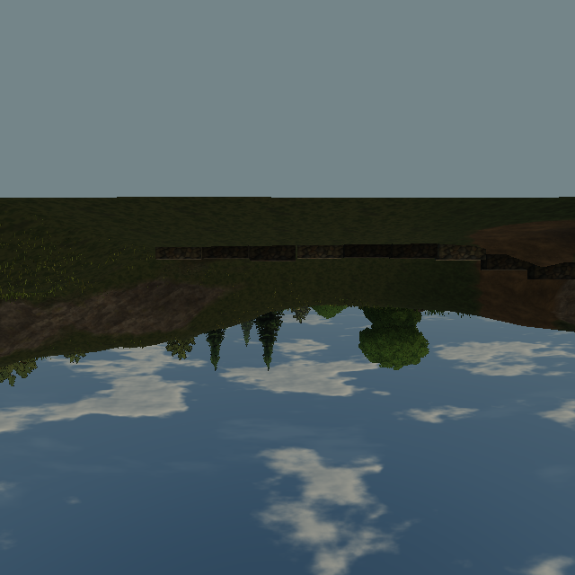
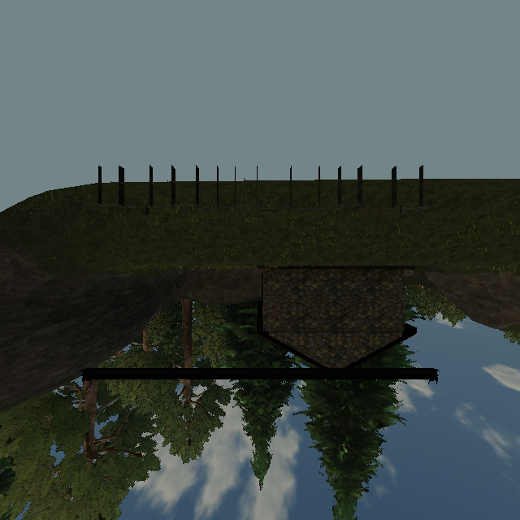

# Grass tiles missing from shrine window captures

Reproduced against [Pages](https://ael-dev3.github.io/Tervain/) **0.0.19 · 77c6866**. Related to the grass pop-in / window-view items in [#326](https://github.com/ael-dev3/Tervain/issues/326).

At the shrine, a camera near the east/back corner stands at `(-21.5, 9.733, -110)`. Its window cube captures from the room centre, `(-28, 9.733, -106)`. A resident near-grass tile at `[-48,-36] × [-96,-84]`, containing 329 clumps, is outside the main camera's grass band but inside the capture's. The main update hides its mesh. Three.js skips invisible meshes before `onBeforeRender`, so the existing capture-camera rank selection never gets a chance to restore it.

Temporarily admit eligible resident tiles while drawing each window face, and restore their original visibility afterward. The existing callbacks still select and restore each face's instance counts. No new tiles are generated; streaming quotas, shaders, density, draw distance and the main view are unchanged. Water reflections keep their existing grass exclusion.

## Verification

The replay runs the published scene, native materials, resident buffers and six native 640px window cube faces at the Medium preset. It substitutes the candidate production `WindowView.update` and `TileLayer.showForCapture` methods on those same objects. Simulation and the shadow map are held fixed. A manual control that admits only the two witnessed tiles must match the production fix on every face. See the [receipt](proofs/window-grass-tiles/report.json) and matched cube-face images below. These images use cube-face coordinates, not the player camera.

| Before | After |
| --- | --- |
|  |  |
|  |  |

Results: the near tile goes from no submissions to 329 instances on each applicable face; a second far tile recovers three surviving instances. Two cube faces change by 99 and 475 pixels. All six repeated and manual-control faces match the fix exactly. Tile visibility/counts restore in every mode. The primary-view control has **zero changed pixels**, with **345 draws, 5,142,791 triangles and 275 texture objects** unchanged (shadow refresh held off).

Run against the published build with a trusted Chrome HTTPS connection:

```sh
node tools/repro-live-window-grass-tiles.mjs --url https://ael-dev3.github.io/Tervain/ --out window-grass-proof
npx vitest run tests/presentation/grassCaptureTiles.test.ts tests/presentation/grassCaptureRanks.test.ts tests/presentation/grassEngine.test.ts tests/presentation/windowView.test.ts tests/presentation/groundcoverMovers.test.ts tests/presentation/worldLoading.test.ts
npm run build
```

The receipt must fail if no tile is missing, no pixels change, visibility/counts fail to restore, repeated fixed captures differ, or the primary-view control changes. The primary-view control holds panes out because their corrected capture is an intentional difference. Regression tests also cover empty/out-of-range tiles, disabled layers, nested scopes, already-visible tiles and a render exception.

Software WebGL verifies correctness only. Hardware frame pacing and a normal-play window clip remain for review; this is not a Mac GPU performance receipt or a claim that foliage quality is complete.
