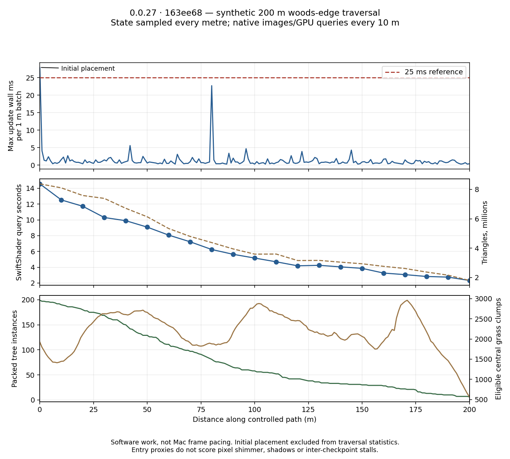

# Live 0.0.27: 200 m woods-edge pop-in and cost scan

**Collection evidence, not a visual or 60 Hz PASS.** Compiled published build **0.0.27 · 163ee68**, High, native software WebGL/MSAA4 at 640×360. Route: world XZ **(-55,70) → (-255,70)**, through woods, the grove hillside and the western clearing. It leaves the denser forest; this is not 200 m of uniformly dense forest.

## Method and coverage

201 packed-state samples at one-metre intervals; 23 interpolated presentation updates per metre (1/23 m per 1/60 s step, nominal 2.609 m/s). Player placement and terrain-following camera are scripted; domain simulation/input locomotion, collisions and wind are held. Camera clearance is clamped to at least 1.5 m. This is a controlled traversal, not an input-driven walking clip.

21 **native** whole-scene image/timer checkpoints at 0,10,…,200 m. Software rendering every metre would take nearly an hour, so intermediate samples inspect packed geometry requests. At every native checkpoint, central-view tree sets/coverage and eligible grass sets match those proxy observations: **zero missing, extra or coverage-mismatch entries**. The collection is nonempty (initially 199 packed leaf-tree instances and 1,923 eligible central grass clumps). Zero console errors; all 200 m completed.

Tree entry candidates require a requested-coverage increase greater than 0.5, with the leaf-bound centre in the central 80% viewport at both samples. Grass candidates require a new packed clump with approximate density/band presence >0.25 in that same central view. The previous grass set includes all packed prefixes, preventing normal threshold crossings from becoming births. This is not exact blade visibility, opaque-leaf connectivity, pixel-level pop detection or an occlusion-aware classifier. Checkpoint validation corroborates the proxy at those samples only.

## Findings

| Measure | Result |
| --- | ---: |
| Abrupt tree-entry candidates | 0 / 200 m = **0/m** |
| Abrupt grass-entry candidates | 0 / 200 m = **0/m** |
| Observed LOD handovers | **72**, all shrubs |
| Traversal presentation updates | **4,600** |
| Update wall ms: mean / p95 / max | **0.310 / 0.700 / 22.700** |
| Traversal updates >25 ms | **0** |
| Initial-placement maximum, excluded above | **27.9 ms** |
| Shader program links after load | **0** |

Observed shrub approach distances (one-metre sampling):

| Transition | Count | Root XZ distance from camera |
| --- | ---: | ---: |
| Far → middle+far | 32 | 89.05–89.96 m |
| Middle+far → middle | 21 | 59.05–59.98 m |
| Middle → near+middle | 10 | 33.06–33.97 m |
| Near+middle → near | 9 | 21.11–21.97 m |

These agree with the expected 60–90 m and 22–34 m shrub bands. They are handovers, not detected defects. High normally keeps ordinary trees at near detail; its horizon fade is 900–1020 m. Consequently this pass **does not test ordinary-tree far-LOD transitions**. Grass's configured density endpoint is 108 m; the proxy threshold does not measure perceived grass draw distance.

The strongest traversal update lead is the batch ending at metre 80, around hero **(-134.09,70)** at its largest interpolated step: **22.7 ms** for world presentation update. In that batch, groundcover's largest module call was **21.9 ms**. Module maxima are aggregated over the batch, so this is a profiling lead, not a proven same-call attribution or a reproduced M5 stall. Initial placement separately reaches 27.9 ms, with groundcover's batch maximum 23.6 ms; it is a camera/position jump, not steady walking.

Native SwiftShader query checkpoints range **2.323–14.556 seconds**. The largest is initial placement; geometry/view complexity declines toward the clearing. These are not Mac frame times. Rendering includes observer work/submission gaps; presentation update wall time excludes render observation but includes module timer wrappers. No whole-App CPU or refresh-cadence measurement is claimed.

Observed buffer/texture source uploads total **24.98 MiB** under the **sparse render schedule**, excluding uniforms and initial world load. These coalesced checkpoint uploads cannot be compared directly to continuous 60 Hz upload traffic or historical gate totals.

[Start](proofs/woods-walk-live27/000.png) · [Grove hillside, 80 m](proofs/woods-walk-live27/080.png) · [Western clearing, 200 m](proofs/woods-walk-live27/200.png)

## Reproduce

Run `node tools/measure-woods-pop-in.mjs --out <output-directory>`, then `node tools/summarize-woods-pop-in.mjs <report.json> <summary.json>`. The default is 200 m with native checkpoints every 10 m. `--length 10 --native-every 1` provides a short dense control; `--profile mac --headed true` selects the larger profile on a hardware browser. The browser path/renderer must be configured separately. `tools/plot-woods-pop-in.py` optionally plots the receipt with matplotlib.

[Summary](proofs/woods-walk-live27/summary.json) · [Raw compressed receipt](proofs/woods-walk-live27/report.json.gz). The analyzer asserts exact route/sample/checkpoint coverage, positive native draws, valid times and zero checkpoint mismatches; these are collection checks, not a game-quality gate. [Negative controls](proofs/woods-walk-live27/collection-controls.json) confirm that a missing sample or mismatched native checkpoint is rejected.

Still open: continuous real-play/60 Hz timing, turns and reverse approaches, shadow-only LOD changes, pixel-visible alpha/white-speck shimmer, and short events between native checkpoints. These zero candidate counts do not close the pop-in issue.
