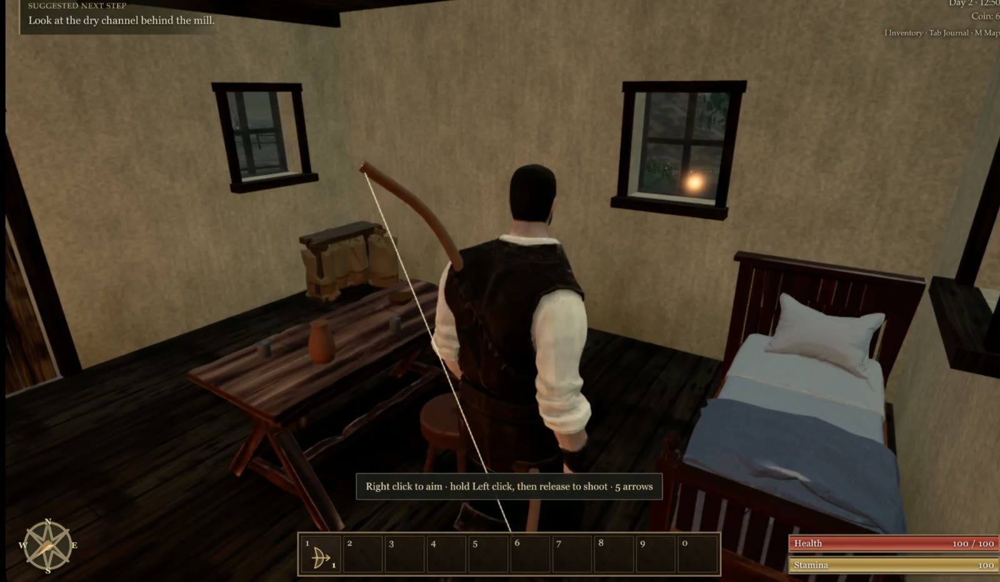
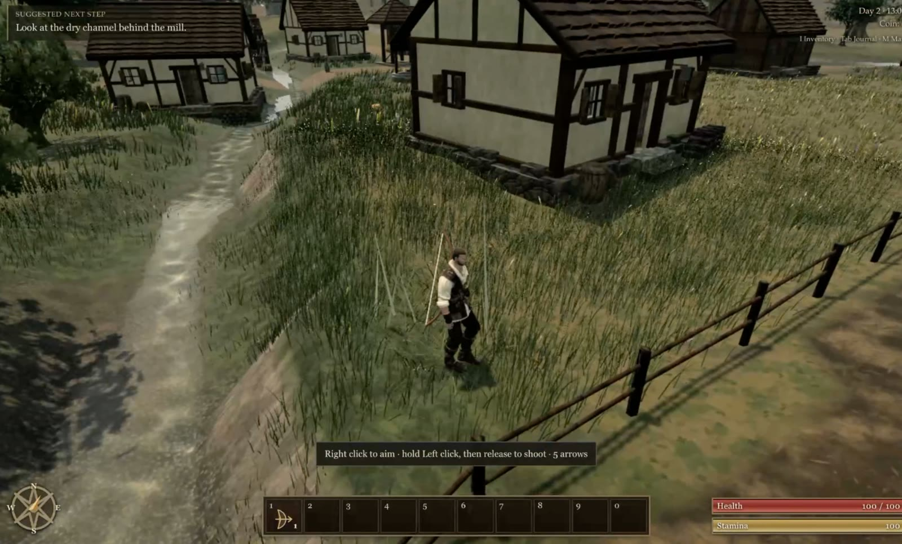
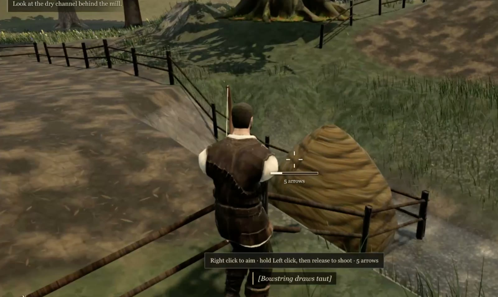
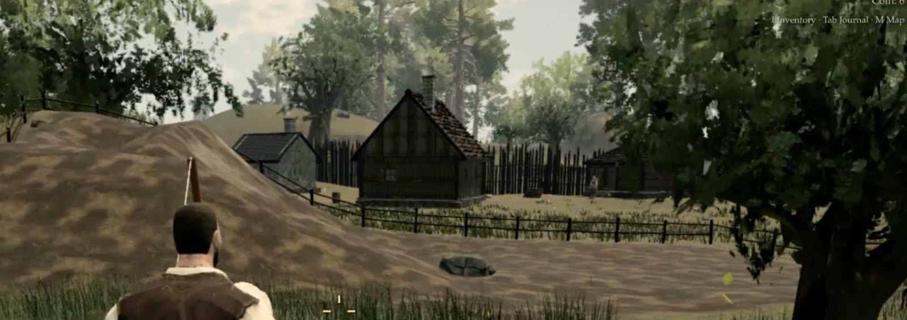

# Playtest 4 (build 2690343, 2026-10-12)

Played in Chrome on a Mac at 60 Hz on the hosted build. The list below is tracked on the pinned issue
"Playtest 4 overhaul (0.0.14+)", where items are ticked as their fixes go live. A fix counts once it is live on
https://ael-dev3.github.io/Tervain/ and shown with before/after shots, clips or frame times. Versions continue 0.0.14,
0.0.15, …

## Findings

1. **Interiors.** Every house should be unique, homey and lived in, like Gothic 3's houses (described under
   References). Needed: a working hearth with warm light, food, tools, shelves, clutter, rugs, beds against walls,
   believable layouts, and ambient occlusion so nothing floats. A light leak (a glowing dot) shows in a window from
   inside but not from outside ([shot 1](shot-1.jpg)).
2. **Village.** The ten houses look identical; exteriors and layouts need variety (sizes, roofs, yards, props)
   ([shot 2](shot-2.jpg)).
3. **Bow.** Grip and hold, bow and string clipping through the body, stiff draw arms, aim camera, crosshair and UI, and
   impact (draw tension, release recoil, sound, arrow flight, hit reactions, screen feedback).
4. **Trees.** Crowns are still dark, flat, noisy and blocky. Falling leaves are flat and untextured. A stump or blob
   pokes out of the ground unnaturally.
5. **Grass.** It appears in a hard radius right in front of the player (pop-in), sways in uniform clumps that shear
   together, and smears during camera pans.
6. **Terrain.** Flat terraces, sharp ridges, 45° cut banks around the pens, a smooth bare dirt mound, a rock floating on
   the surface, and low-resolution tiling mud ([shot 3](shot-3.jpg), [shot 4](shot-4.jpg)). It needs natural blending.
7. **Fences.** There is no jump, and the player glides over fences as if they were ramps. Add a jump or vault and proper
   fence collision ([shot 3](shot-3.jpg)).
8. **Doorframe camera.** On leaving a house the camera clips through the doorframe and shows the walls are hollow.
9. **Stutter and animation.** Hitches when turning and while new areas stream in. Foot sliding and stiff animation for
   the player and for residents.
10. **Image quality.** Aliasing on fences, roofs and grass. Outdoor shadows flicker.
11. **Main menu.** Tall black slabs or pillars block the view of the sea.
12. **UI.** The permanent tutorial prompt and debug-looking subtitle cues need proper styling, or should fade out.

The music and ambience were well liked: leave them as they are.

Also seen in the video: low-resolution repeating mud and fireplace-stone textures, and stiff resident animation.

## Video notes (timestamps)

- 0:04, 0:18, 0:21, 0:28, 0:35, 0:45: stutters and hitches, worst when turning the camera and while new areas stream in.
- 0:13–0:14: the camera clips through the doorframe on the way out.
- 0:15–0:21, 0:45–0:50: grass appears in a hard radius just ahead of the player, sways in uniform clumps and smears
  during pans.
- 0:21–0:25, 0:36–0:45: terraced terrain and harsh 45° cut banks around the pen.
- 0:23, 0:49: no jump; the player glides over fences.
- 0:02–0:31: the bow clips through the torso, the draw is stiff and the string passes through the arm.
- 0:04–0:12: a light leak in the window, a bed that looks like it floats, sparse furniture.
- 0:15, 0:35: outdoor shadow flicker; aliasing on fences, roofs and grass.
- 0:38–0:40: flat untextured falling leaves; dark, blocky tree crowns.

## Screenshots

| | |
| --- | --- |
|  |  |
|  |  |

## References

Six screenshots of Gothic 3 house interiors (g3-1 to g3-6) were the reference for item 1. They are not reproduced here.
What they show:

- Rooms built from dark timber boards and beams, with the roof structure visible overhead and stone walls in places.
- A round stone hearth or oven near the middle of the room, giving warm, low, flickering light.
- Red woven rugs before the hearth.
- Rooms full of a household's things: pots and jugs on shelves, bottles, tools and weapons on racks, a cart wheel and
  antlers or a boar's head on the walls, hanging herbs, candles and a wheel chandelier.
- Benches and long tables set with food, barrels and sacks in corners, a workbench by the wall.
- Deep, warm shadows in the corners, so every object sits firmly on the floor.
